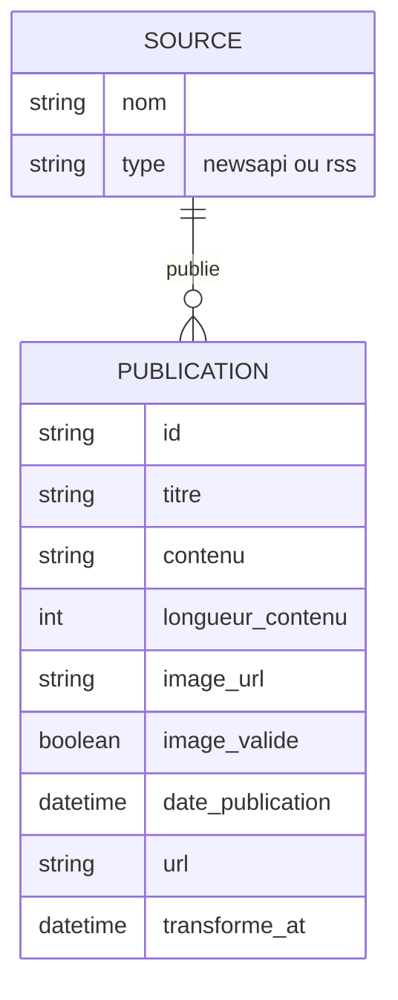

# Schéma conceptuel des données — pipeline CheckIt.AI

**Étape** : 3 — Modèle conceptuel (indépendant de toute technologie de stockage)

> ⚠️ Ce document décrit le **modèle conceptuel** (entités, attributs, relations, sens métier),
> pas le schéma physique. Le choix du SGBD, des types de colonnes SQL, des index et des clés
> techniques est traité à l'étape 4 (Airflow / base de données).

---

## 1. Entités et relation

Une **Source** (un flux RSS ou l'API NewsAPI) publie plusieurs **Publications**. Une publication
appartient à une seule source.

## 2. Dictionnaire des champs (entité PUBLICATION)

| Champ | Type conceptuel | Rôle dans le cas d'usage IA | Origine |
|---|---|---|---|
| `id` | Identifiant (texte) | Clé de dédoublonnage entre sources (hash de l'URL) | Calculé à la transformation |
| `titre` | Texte court | Signal principal pour le NLP (classification du contenu) | Extraction, nettoyé à la transformation |
| `contenu` | Texte long | Corps du texte pour l'analyse NLP approfondie | Extraction, nettoyé à la transformation |
| `longueur_contenu` | Nombre entier | Indicateur de richesse du texte (filtrage qualité) | Calculé à la transformation |
| `image_url` | URL | Modalité image du couple texte+image | Extraction |
| `image_valide` | Booléen | Filtre qualité : image réellement accessible (vérification HEAD) | Calculé à la transformation |
| `date_publication` | Date/heure (ISO 8601 UTC) | Fraîcheur de l'information, corrélation temporelle d'évènements | Extraction, normalisée à la transformation |
| `url` | URL | Traçabilité, vérification manuelle de la publication d'origine | Extraction |
| `source_type` | Catégorie (`newsapi` / `rss`) | Permet de pondérer/filtrer par fiabilité de canal | Extraction |
| `transforme_at` | Date/heure | Audit : horodatage du passage dans le pipeline | Calculé à la transformation |

## 3. Dictionnaire des champs (entité SOURCE)

| Champ | Type conceptuel | Rôle |
|---|---|---|
| `nom` | Texte | Nom lisible de la source (ex. "Le Monde", "NewsAPI") |
| `type` | Catégorie | Distingue les canaux API des flux RSS pour le suivi des quotas et de la fiabilité |
| `domaine` | Texte | Nom de domaine extrait de l'URL — indice de fiabilité déclarée d'un éditeur |

## 4. Alignement avec le cas d'usage IA

- **Classification (fake/opinion/vrai)** : `titre` + `contenu` sont les entrées texte du futur modèle ; `image_url`/`image_valide` fournissent la modalité image associée.
- **Filtrage qualité en amont du modèle** : `image_valide` et `longueur_contenu` permettent d'exclure les publications non exploitables avant l'entraînement.
- **Explicabilité / audit** : `url`, `source_type`, `transforme_at` permettent de retracer chaque prédiction jusqu'à sa publication d'origine — important dans un contexte de lutte contre la désinformation où la traçabilité de la source est elle-même une preuve.

## 5. Ce que ce schéma n'est pas

- Ce n'est **pas** un schéma SQL : pas de type `VARCHAR(255)`, pas de clé primaire technique auto-incrémentée, pas d'index. Ces décisions seront prises à l'étape 4 selon le SGBD retenu.
- Ce n'est **pas** un schéma d'entraînement du modèle IA (features engineering, embeddings) : c'est la structure de la donnée *avant* toute transformation propre au machine learning.
