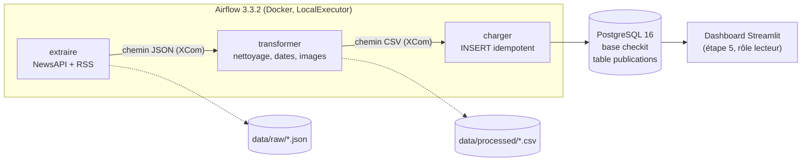

# Orchestration Airflow et base de données — pipeline CheckIt.AI

**Étape** : 4 — Flux ETL automatisé avec Apache Airflow, chargement dans une base sécurisée

---

## 1. Vue d'ensemble



| Élément | Choix |
|---|---|
| DAG | `checkit_etl`, fichier `airflow/dags/checkit_etl.py` |
| Tâches | 3 `PythonOperator` : `extraire >> transformer >> charger` |
| Planification | Tous les jours à 6h UTC (`0 6 * * *`), sans rattrapage (`catchup=False`) |
| Robustesse | 2 nouvelles tentatives par tâche, espacées de 5 minutes |
| Passage de données entre tâches | Seul le **chemin** du fichier transite par XCom, pas les données elles-mêmes |

Les tâches appellent directement les fonctions des étapes 2 et 3 (`extraction.main.run`,
`transformation.main.run`) et le nouveau module `chargement`. Le code du projet n'est pas dupliqué dans
le DAG : il est monté dans le conteneur (`/opt/checkit/src`) et ajouté au `PYTHONPATH`.

## 2. Choix de la base : PostgreSQL

| Critère | Analyse |
|---|---|
| Structure des données | Schéma fixe et connu (11 champs, cf. `docs/02`) : un modèle relationnel convient |
| Unicité | `id` (hash de l'URL) est une clé naturelle. La contrainte `PRIMARY KEY` garantit l'absence de doublons au niveau de la base, quel que soit le code qui écrit |
| Requêtes analytiques | Agrégations SQL (par source, par jour, % d'images valides) directement exploitables par le dashboard de l'étape 5 |
| Images | On stocke l'**URL** de l'image, pas le fichier : pas besoin d'un stockage objet à ce stade |
| Coût d'exploitation | Le même serveur héberge déjà les métadonnées d'Airflow : un seul service à surveiller |

Une base NoSQL (MongoDB) aurait été pertinente si les publications avaient des structures très
variables d'une source à l'autre. Ici l'extraction normalise déjà tout vers un schéma commun.

## 3. Schéma physique

Traduction technique du modèle conceptuel de `docs/02` (script : `db/init/01_init_bases.sh`).

| Colonne | Type PostgreSQL | Contrainte |
|---|---|---|
| `id` | `CHAR(16)` | `PRIMARY KEY` |
| `titre` | `TEXT` | `NOT NULL` |
| `contenu` | `TEXT` | |
| `longueur_contenu` | `INTEGER` | `>= 0` |
| `image_url` | `TEXT` | |
| `image_valide` | `BOOLEAN` | `NOT NULL`, défaut `FALSE` |
| `date_publication` | `TIMESTAMPTZ` | index |
| `domaine_source` | `TEXT` | |
| `url` | `TEXT` | `NOT NULL UNIQUE` |
| `source_type` | `TEXT` | `IN ('newsapi', 'rss')`, index |
| `transforme_at` | `TIMESTAMPTZ` | `NOT NULL` |
| `charge_at` | `TIMESTAMPTZ` | `NOT NULL`, défaut `now()` |

**Idempotence** : le chargement utilise `INSERT ... ON CONFLICT (id) DO NOTHING`. Relancer une
tâche, ou recharger un article déjà vu la veille, ne crée ni doublon ni erreur.

## 4. Sécurité

### 4.1 Authentification
- Mots de passe hachés en **SCRAM-SHA-256** (`--auth-host=scram-sha-256`), aucune connexion en mode `trust`.
- PostgreSQL et l'interface Airflow ne sont exposés que sur `127.0.0.1` : inaccessibles depuis le réseau.
- Interface Airflow protégée par identifiant et mot de passe (FAB auth manager, compte admin créé à l'initialisation).

### 4.2 Rôles et moindre privilège

| Rôle | Utilisé par | Droits sur `publications` |
|---|---|---|
| `postgres` | Initialisation uniquement | Superutilisateur |
| `airflow` | Métadonnées Airflow | Aucun : il n'a accès qu'à la base `airflow` |
| `checkit_etl` | Tâche `charger` | `SELECT`, `INSERT` : ni `UPDATE`, ni `DELETE`, ni création de table |
| `checkit_lecteur` | Dashboard (étape 5) | `SELECT` uniquement |

`CONNECT` sur les bases et `CREATE` sur le schéma `public` sont retirés à `PUBLIC` : un nouveau rôle
n'a accès à rien par défaut.

### 4.3 Chiffrement et gestion des secrets
- Tous les secrets sont dans `.env`, exclu de git. `.env.example` documente les variables sans valeurs.
- Les identifiants de `checkit_etl` sont stockés dans une **Connection Airflow chiffrée par la clé
  Fernet** : en base, le mot de passe n'apparaît que sous forme de jeton chiffré (`gAAAAA...`).
- Chaque conteneur ne reçoit que les secrets dont il a besoin : les tâches n'ont pas le mot de
  passe de la base métier en variable d'environnement, elles le lisent depuis la Connection.
- **Données au repos** : les publications sont des articles de presse **publics**, sans donnée
  personnelle (le champ `author` de NewsAPI n'est pas conservé). Un chiffrement colonne par colonne
  (`pgcrypto`) n'apporterait pas de protection utile et empêcherait les requêtes analytiques.
- **Limite connue** : les échanges entre conteneurs ne sont pas chiffrés (pas de TLS), ce qui est
  acceptable sur le réseau Docker interne d'une machine locale. En production, il faudrait activer
  TLS sur PostgreSQL et placer l'interface Airflow derrière HTTPS.

## 5. Lancer le pipeline

```bash
cp .env.example .env               # renseigner NEWSAPI_KEY et générer les secrets
docker compose up -d --build       # premier démarrage : ~2 Go d'image à télécharger
# Interface : http://localhost:8080 (AIRFLOW_ADMIN_USER / AIRFLOW_ADMIN_PASSWORD)
docker compose exec airflow-scheduler airflow dags unpause checkit_etl
docker compose exec airflow-scheduler airflow dags trigger checkit_etl
```

## 6. Preuves d'exécution (9 octobre 2026)

Deux runs exécutés avec succès : le run planifié de 6h (déclenché à l'activation du DAG) et un run manuel.

| Tâche | Résultat |
|---|---|
| `extraire` | 50 articles NewsAPI + 48 entrées RSS (Le Monde 16, France Info 32) |
| `transformer` | 98 publications valides, 0 rejetée, 96 images accessibles, en ~28 s |
| `charger` (1er run) | `98 nouvelle(s) publication(s) / 0 déjà présente(s)` |
| `charger` (2e run, même fichier, cf. incident ci-dessous) | `0 nouvelle(s) publication(s) / 98 déjà présente(s)` : idempotence vérifiée |

Après correctifs, un 3e run (manuel, 9h45 UTC) réussit en ~30 s dès la première tentative :
`6 nouvelle(s) publication(s) / 92 déjà présente(s)`. Seuls les articles parus entre-temps sont
ajoutés : la déduplication fonctionne aussi d'un run à l'autre (104 publications en base).

Contrôles de sécurité effectués :
- `DELETE` avec `checkit_lecteur` puis avec `checkit_etl` : `permission denied for table publications` dans les deux cas.
- Mot de passe de la Connection `checkit_postgres` en base airflow : `is_encrypted = true`.

Incidents rencontrés et corrigés :

- **Collision de fichiers** : les deux runs ont démarré dans la même seconde et ont écrit le même
  `extraction_<horodatage>.json`, car l'horodatage s'arrête à la seconde. Le second run a donc
  traité le fichier du premier. Correctif : `max_active_runs=1` sur le DAG, les runs s'exécutent
  l'un après l'autre.
- **Pilote PostgreSQL** : en Airflow 3.3, `PostgresHook.get_conn()` renvoie une connexion
**psycopg 3**, incompatible avec `execute_values` de **psycopg2**. La tâche lit désormais les
identifiants via le hook et ouvre elle-même la connexion psycopg2. Les 2 tentatives automatiques
ont permis de relancer `charger` sans réexécuter l'extraction ni la transformation.

Captures d'écran de l'interface Airflow (vue Grid, logs de tâches) : `docs/captures/` *(à ajouter)*.
