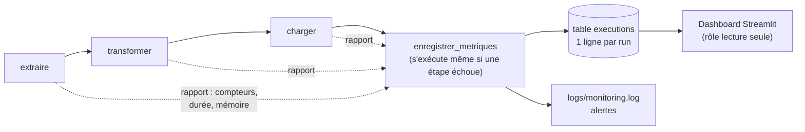

# Plan de monitoring — pipeline CheckIt.AI

**Étape** : 5 — Indicateurs de performance, tableau de bord et surveillance en production

Ce plan ne décrit que ce qui est **réellement automatisé** dans le projet. Chaque seuil cité ici
est lu dans `src/monitoring/config.py`, le même fichier qu'utilisent le DAG et le dashboard :
le document, l'alerte et l'affichage ne peuvent pas diverger.

---

## 1. Ce qui est mesuré, et où



Chaque étape renvoie un **rapport** (ses compteurs). Le DAG y ajoute la durée et la mémoire
maximale. La dernière tâche assemble les trois rapports, compare aux seuils et écrit une ligne
dans la table `executions`, alertes comprises.

## 2. Indicateurs (KPI)

| Famille | Indicateur | Calcul | Valeur normale observée |
|---|---|---|---|
| **Précision** | Données valides | `nb_valides / nb_extraits` | 98 à 100 % |
| | Images accessibles | `nb_images_valides / nb_valides` | 96 à 100 % |
| | Fraîcheur | nouveaux articles par run (`nb_nouvelles`) | ~95 au premier run du jour, quelques-uns si deux runs sont rapprochés |
| **Volume** | Articles collectés par source | `nb_newsapi`, `nb_rss` | 50 NewsAPI + ~47 RSS |
| **Rapidité** | Durée par étape | chronométrée autour de chaque étape | extraction ~1 s, transformation ~25 s, chargement < 1 s |
| | Durée totale | somme des 3 étapes | ~25-30 s |
| **Fiabilité** | Runs réussis | `runs en succès / runs enregistrés` | 100 % |
| **Coût** | Quota NewsAPI | appels du jour / 100 | 1 par run planifié |
| | Mémoire maximale | pic de mémoire du processus d'une étape | ~240 Mo |
| | Stockage | taille des fichiers JSON + CSV produits | ~165 Ko par run |

La transformation représente plus de 90 % du temps : elle vérifie une à une l'accessibilité de
chaque image (requête HEAD). C'est le premier levier d'optimisation si le volume augmente.

## 3. Seuils d'alerte

| Indicateur | Alerte si | Niveau | Pourquoi ce seuil |
|---|---|---|---|
| Échec d'une étape | après 2 nouvelles tentatives à 5 min d'intervalle | **Critique** | Le pipeline n'a pas produit de données ce jour-là |
| Une source ne renvoie rien | 0 article NewsAPI **ou** 0 entrée RSS | **Critique** | Clé expirée, quota dépassé, flux déplacé : le run « réussit » mais il manque une source |
| Données valides | < 90 % | Attention | Valeur normale ~100 % : une baisse signale un changement de format côté source |
| Images accessibles | < 80 % | Attention | Le cas d'usage est multimodal : un article sans image perd la moitié de sa valeur |
| Articles collectés | < 50 | Attention | Un run normal en ramène ~97 ; la moitié signale une source dégradée |
| Durée d'un run | > 300 s | Attention | 10 fois la durée normale : sites lents ou timeouts en série |
| Appels NewsAPI du jour | > 80 | Attention | Le plan gratuit coupe à 100 : on prévient avant la coupure |

Les deux niveaux ont un sens précis :
- **Critique** : les données du jour sont absentes ou incomplètes. Il faut intervenir le jour même.
- **Attention** : les données sont là mais leur qualité baisse. À analyser, sans urgence.

## 4. Mécanismes automatiques en place

| Mécanisme | Configuration | Effet |
|---|---|---|
| Nouvelles tentatives | `retries=2`, `retry_delay=5 min` | Une panne réseau passagère se résout seule, sans relancer les étapes déjà réussies |
| Délai maximal par tâche | `execution_timeout=10 min` | Une tâche bloquée est tuée puis retentée au lieu de bloquer le pipeline |
| Délai maximal par run | `dagrun_timeout=30 min` | Un run qui n'en finit pas est marqué en échec |
| Un seul run à la fois | `max_active_runs=1` | Pas d'écrasement de fichiers, pas de double consommation du quota |
| Alerte d'échec de tâche | `on_failure_callback` | Écrit une ligne `CRITIQUE` dans `logs/monitoring.log` |
| Évaluation des seuils | tâche `enregistrer_metriques` (`trigger_rule=ALL_DONE`) | Alertes enregistrées en base et dans `logs/monitoring.log` (ERROR pour critique, WARNING pour attention) |
| Run en échec visible | la tâche de métriques échoue volontairement si une étape a échoué | Le run reste rouge dans Airflow au lieu d'apparaître vert |
| Chargement idempotent | `ON CONFLICT DO NOTHING` | Une relance ne crée jamais de doublon : on peut toujours relancer sans risque |

## 5. Fréquence des vérifications

| Quand | Quoi | Qui / comment |
|---|---|---|
| Chaque jour, à 6h UTC | Exécution du pipeline et évaluation automatique des seuils | Airflow, automatique |
| Chaque jour, en début de journée | Lire le bandeau « Dernier run » du dashboard (vert / orange / rouge) | Équipe data, 1 minute |
| Chaque semaine | Tendances : taux de validité, durée, volume par source | Dashboard, sections Précision, Volume, Rapidité |
| Chaque mois | Revoir les seuils à partir des valeurs observées ; purger les fichiers intermédiaires anciens | Équipe data |
| À chaque modification du code | `pytest` (règles d'alerte) puis un run manuel du DAG | Développeur |

## 6. Que faire en cas d'alerte

| Alerte | Premier diagnostic |
|---|---|
| Échec de « extraire » | Logs de la tâche dans Airflow. Tester la clé NewsAPI et l'URL des flux RSS dans un navigateur |
| Échec de « transformer » | Fichier brut du run dans `data/raw/` : format inattendu ? champ manquant ? |
| Échec de « charger » | `docker compose ps` : PostgreSQL est-il « healthy » ? La Connection `checkit_postgres` existe-t-elle ? |
| NewsAPI à 0 | Quota du jour dépassé ou clé expirée : vérifier le message d'erreur dans `logs/extraction.log` |
| Images accessibles en baisse | Un éditeur bloque peut-être les requêtes HEAD : regarder `domaine_source` des images refusées |
| Run lent | Durée par étape dans le dashboard. La transformation est la suspecte habituelle (timeouts d'images) |

Une fois la cause corrigée : bouton **Clear** sur la tâche en échec dans Airflow. Seule cette tâche
et les suivantes sont rejouées, et la ligne du run dans `executions` est mise à jour.

## 7. Limites actuelles et passage en production

Ce qui fonctionne en local mais devrait évoluer en production :

| Limite | Évolution prévue |
|---|---|
| Les alertes restent dans un fichier de log : personne n'est notifié | Brancher `on_failure_callback` et les alertes critiques sur un canal (e-mail, Slack, PagerDuty) |
| Le monitoring ne détecte pas un run **qui n'a pas eu lieu** (scheduler arrêté) | Contrôle externe : alerte si aucune ligne dans `executions` depuis plus de 26 h |
| La mémoire est mesurée par étape, pas pour l'ensemble des conteneurs | Collecte des métriques Docker (cAdvisor, Prometheus) et des métriques Airflow (StatsD) |
| Les fichiers intermédiaires s'accumulent dans `data/` | Tâche de purge des fichiers de plus de 30 jours |
| Le dashboard tourne en local, sans authentification | Le déployer derrière une authentification (il ne lit déjà qu'avec un rôle en lecture seule) |

## 8. Lancer le dashboard

```bash
.venv/Scripts/streamlit run dashboard/app.py      # http://localhost:8501
```

Prérequis : le PostgreSQL du `docker-compose` démarré et `CHECKIT_LECTEUR_PASSWORD` dans `.env`.
